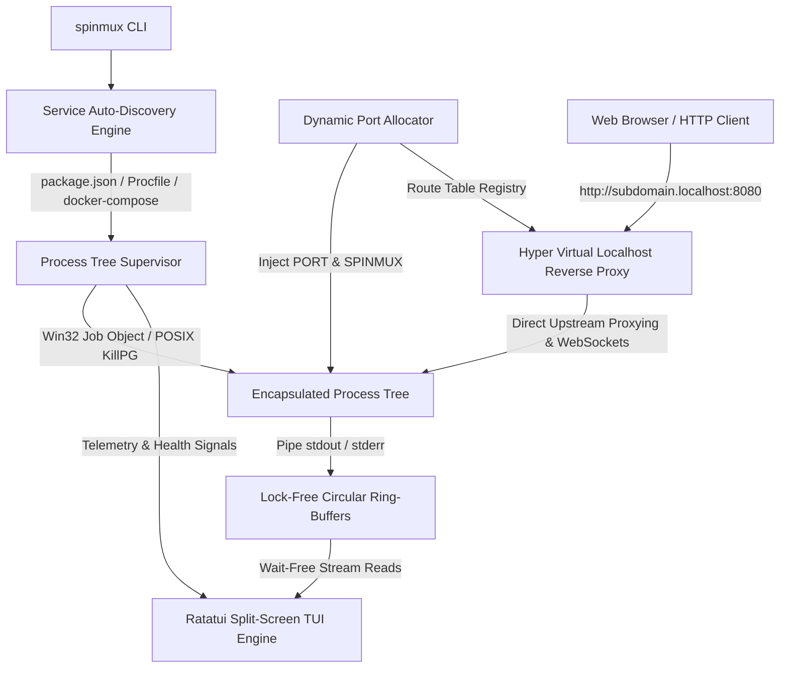

# spinmux

<p align="center">
  <strong>Autonomous Multi-Service Development Cockpit</strong><br>
  <em>Auto-discover local services, route virtual localhost subdomains, and supervise processes with zero orphans.</em>
</p>

<p align="center">
  <a href="https://github.com/shenald-dev/spinmux/actions/workflows/ci.yml"></a>
  <a href="https://github.com/shenald-dev/spinmux/releases"></a>
  <a href="LICENSE"></a>
  <a href="https://www.rust-lang.org"></a>
  
</p>

---

## Overview

**`spinmux`** is a high-craft terminal cockpit built for developers working with multi-service architectures. Instead of wrestling with multiple terminal tabs, leaked background processes, port collision errors, and cumbersome `/etc/hosts` configurations, `spinmux` provides an integrated runtime environment:

- **Auto-Discovery**: Instantly inspects `package.json` scripts, `Procfile` configurations, and `docker-compose.yml` to extract and configure runnable services.
- **Zero-Orphan Process Supervision**: Spawns and supervises process trees inside native **Windows Job Objects** (`JOB_OBJECT_LIMIT_KILL_ON_JOB_CLOSE`) and POSIX process groups. If `spinmux` exits, every child and grandchild process is guaranteed to terminate cleanly.
- **Ephemeral Virtual Subdomain Proxy**: Embeds a high-performance `hyper` reverse proxy routing `http://<service>.localhost:<port>` to dynamic local service ports.
- **Electric Cyan/Violet TUI**: Split-screen terminal dashboard powered by `ratatui` and `crossterm` running at sub-15ms event-driven rendering latency with interactive keystroke controls.
- **Lock-Free Ring-Buffers**: In-memory circular log ring-buffers capturing high-throughput stdout and stderr without blocking async runtime workers.

---

## Terminal Cockpit Walkthrough

```text
+-------------------------------------------------------------------------------------------------------+
|  SPINMUX v0.1.0  |  Proxy: http://localhost:8080  |  Services: 3/3 active  |  Latency: 4.2ms          |
+---------------------------------------------------+---------------------------------------------------+
|  SERVICE COCKPIT                                  |  LOG STREAM: [frontend]                           |
|                                                   |                                                   |
|  ● frontend (PID 14208)                           |  12:30:01.102 [stdout] Vite v5.2.0 ready in 210ms |
|    URL:  http://frontend.localhost:8080           |  12:30:01.104 [stdout] Local: http://localhost:3000|
|    Port: 3000 -> 8080                             |  12:30:05.412 [stdout] GET / 200 OK - 12ms        |
|    Restarts: 0                                    |  12:30:08.891 [stdout] GET /api/v1/user 200 OK    |
|                                                   |                                                   |
|  ● api (PID 14210)                                |                                                   |
|    URL:  http://api.localhost:8080                |                                                   |
|    Port: 4000 -> 8080                             |                                                   |
|    Restarts: 0                                    |                                                   |
|                                                   |                                                   |
|  ● worker (PID 14212)                             |                                                   |
|    URL:  [background]                             |                                                   |
|    Restarts: 0                                    |                                                   |
+---------------------------------------------------+---------------------------------------------------+
| [r] Restart  [s] Stop  [a] Start All  [x] Stop All  [Tab/j/k] Navigate  [Space] Pause  [c] Clear  [q] Quit |
+-------------------------------------------------------------------------------------------------------+
```

---

## System Architecture



---

## Key Feature Highlights

### 1. Service Auto-Discovery
`spinmux` searches your workspace root for service declarations, eliminating manual run configurations:
- **`package.json`**: Inspects `scripts` for development services (`dev`, `start`, `serve`, `api`, `worker`, etc.) while filtering out unit tests and linters.
- **`Procfile`**: Parses Foreman/Honcho standard format definitions (`web: python -m http.server`, `worker: celery worker`).
- **`docker-compose.yml`**: Discovers services, commands, and mapped container ports.
- **Precedence Resolution**: Explicit CLI overrides > `Procfile` > `package.json` > `docker-compose.yml`.

### 2. Zero-Orphan Process Supervision
Orphaned node/python/go processes running in the background are a major annoyance on developer machines.
- On **Windows**, `spinmux` binds every child process to a dedicated Win32 **Job Object** configured with `JOB_OBJECT_LIMIT_KILL_ON_JOB_CLOSE`. When the `spinmux` process or handle terminates, the Windows kernel automatically terminates all child and grandchild processes in the job tree.
- On **Linux / macOS**, processes are grouped into independent process groups (`setpgid`) and signaled via `killpg` upon exit with `PR_SET_PDEATHSIG` safeguards.

### 3. Ephemeral Virtual Localhost Reverse Proxy
Say goodbye to remembering random port numbers like `:3000`, `:4200`, `:8000`, `:8080`:
- Dynamically allocates local ports (`127.0.0.1:0`) and injects `PORT=<port>` into child environments.
- Routes incoming HTTP requests via `Host` header inspection:
  - `http://frontend.localhost:8080` $\to$ `127.0.0.1:3000`
  - `http://api.localhost:8080` $\to$ `127.0.0.1:8000`
- Supports transparent streaming, chunked transfers, and bidirectional WebSocket connection upgrades.
- Provides immediate diagnostic 502/503 landing pages with tail log snippets if upstream services crash or are rebooting.

### 4. Electric Cyan / Neon Violet TUI
Designed for high visibility and immediate cognitive clarity:
- **Palette**: Electric Cyan (`#00E5FF`), Neon Violet (`#BD00FF`), and Dark Charcoal (`#121214`).
- **Sub-15ms Latency**: Dirty-flag rendering loop avoids terminal flicker while handling high-throughput log streams.
- **Interactive Process Controls**: Restart, stop, or pause individual services with single keystrokes.
- **Filter Modal**: Instant regex and substring log searching with real-time match counters.

---

## Quickstart

### Installation

#### Download Pre-Compiled Binary (GitHub Releases)
Grab the latest pre-compiled standalone binary for your platform from [GitHub Releases](https://github.com/shenald-dev/spinmux/releases):

```bash
# Using GitHub CLI
gh release download v0.1.0 -R shenald-dev/spinmux
```

#### Build from Source via Cargo
```bash
# Clone and install locally
git clone https://github.com/shenald-dev/spinmux.git
cd spinmux
cargo install --path .
```

### Usage

Run `spinmux` directly in any project folder containing `package.json`, `Procfile`, or `docker-compose.yml`:

```bash
cd my-project
spinmux
```

### CLI Command Options

```text
spinmux [OPTIONS]

Options:
  -d, --dir <PATH>        Target project directory [default: .]
  -p, --port <PORT>       Reverse proxy port [default: 8080]
  -c, --config <FILE>     Explicit configuration file override
      --services <NAMES>  Comma-separated list of services to start
      --no-proxy          Disable virtual localhost reverse proxy
      --headless          Run in headless daemon mode (no TUI)
      --dry-run           Print discovered services and exit without running
  -h, --help              Print help
  -V, --version           Print version
```

---

## RFC 6761 Virtual Localhost Subdomain Routing Guide

Modern web browsers (including Google Chrome, Mozilla Firefox, Apple Safari, and Microsoft Edge) automatically resolve all subdomains of `*.localhost` to IPv4 `127.0.0.1` and IPv6 `::1` natively per **[RFC 6761 Section 6.3](https://datatracker.ietf.org/doc/html/rfc6761#section-6.3)**:

> *"The domain "localhost." and any names falling within ".localhost." are special in the following ways: ... Name resolution APIs and libraries SHOULD recognize these names as special and SHOULD return 127.0.0.1 ... "*

**No `/etc/hosts` or `C:\Windows\System32\drivers\etc\hosts` modifications are required!**

Simply open your browser:
- `http://frontend.localhost:8080`
- `http://api.localhost:8080`

### Testing with `curl`
When testing with CLI HTTP tools such as `curl`:
```bash
# Modern cURL automatically resolves .localhost
curl http://api.localhost:8080/health

# Or explicitly pass the host header
curl -H "Host: api.localhost:8080" http://127.0.0.1:8080/health
```

---

## Interactive Keyboard Cheatsheet

| Shortcut | Mode | Description |
|---|---|---|
| `Tab` / `Down` / `j` | Normal | Navigate down the service list |
| `Shift+Tab` / `Up` / `k` | Normal | Navigate up the service list |
| `r` | Normal | Restart selected service |
| `s` | Normal | Stop selected service |
| `a` | Normal | Start all services |
| `x` | Normal | Stop all services |
| `Space` | Normal | Toggle auto-scroll lock in log window |
| `/` | Normal | Open log search / filter modal |
| `Esc` | Modal / Normal | Close search modal / reset filter |
| `c` | Normal | Clear in-memory log buffer for active service |
| `p` | Normal | Toggle proxy routes overview dialog |
| `?` | Normal | Toggle help & shortcuts cheatsheet |
| `q` / `Ctrl+C` | Any | Gracefully shut down all services and exit |

---

## License

This project is licensed under the MIT License — see the [LICENSE](LICENSE) file for details.
